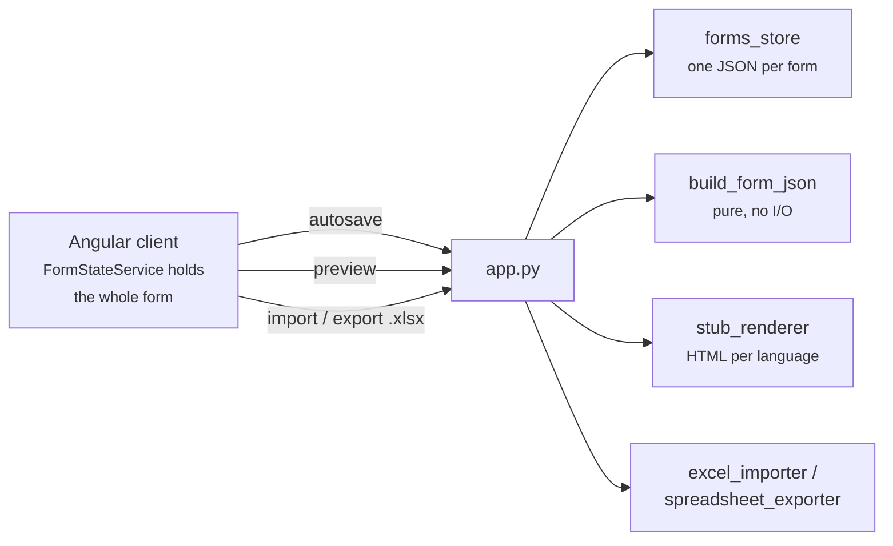

# Architecture

Two processes exchanging one thing: **the form document**. The Angular client owns it and
autosaves it; the Flask service stores it, converts it, and renders it.
`build_form_json` is the single conversion point from document to generator-ready structure.



## Backend modules

| Module | Does |
|---|---|
| `app.py` | Routes. Thin: parse, delegate, stream |
| `json_builder.py` | Document → form-structure JSON. **Pure**, no I/O |
| `forms_store.py` | One JSON file per form, atomic writes; an id pattern blocks path traversal |
| `excel_importer.py` | Workbook → document, plus the coded findings for what it could not read |
| `spreadsheet_exporter.py` | Document + original workbook → updated workbook (overlay) |
| `stub_renderer.py` | Document → one standalone HTML document per language |
| `dictionary.py` | Phrase lookups from `ftl_consts/*.txt` |
| `field_names.py` | What a Fachdatenbezeichner may contain, and the rejection it raises |
| `input_events.py` | The per-field JS handler attribute, parsed and re-emitted |
| `paths.py` | Filename conventions and the storage location |

## Frontend modules

| File | Does |
|---|---|
| `services/form-state.service.ts` | The document, selection, undo/redo, autosave, numbering. Everything else reads it |
| `services/form-storage.service.ts` | `/api/forms` wrapper, generates form ids |
| `services/form-transfer.service.ts` | JSON export/import, workbook upload, re-import |
| `services/import-issues.ts` | Which import findings are still outstanding, recomputed from the document |
| `services/field-names.ts` | The client-side half of the Fachdatenbezeichner rule |
| `services/form-name.ts` | The output base name, mirroring `json_builder.output_base_name` |
| `services/paste-fill.ts` | Multi-value clipboard parsing |
| `services/catalogs.ts` | Country and canton lists |
| `services/tour.service.ts` | First-run walkthrough |
| `components/canvas/` | The form sketch. Dispatches on `component.id` |
| `components/right-sidebar/` | Properties. Which controls appear is decided by per-type helper methods |
| `components/left-sidebar/` | The palette |
| `components/import-issues/` | The outstanding-findings list, and the re-import prompt |
| `components/developer-dialog/` | Deployment settings: naming and ids |
| `components/top-nav-bar/`, `landing-page/`, `tour/` | Page frame, form list, walkthrough |

No router — `formState.view()` switches between `'landing'` and `'editor'`. Signals
throughout, no store library.

`formState.displayLanguage()` is what the canvas and properties panel render, **DE** by
default because imported spec sheets often have no EN. It is not saved, so it resets to DE
on open. It also decides catalog option order (`sortedForBackend`).

**The canvas is a sketch, not the preview.** It uses the builder's own markup for speed of
editing; `/api/preview` is what shows the form as a form.

## Control flow

```
Autosave
  document signal → effect() → debounce 600ms → switchMap(storage.save)
  → PUT /api/forms/<id> → forms_store.save_form (temp file + os.replace)
  catchError sits INSIDE the switchMap: outside, one error would kill the subscription
  and drop every later edit. Cost: a failed save is invisible.

Preview
  POST /api/preview → stub_renderer.render_all
    → one HTML document per language, cached under a token (20 max, in memory)
  GET /preview?id=…&lang=… serves one
```

## Routes

| Path | Notes |
|---|---|
| `GET /` · `/api/heartbeat` | Health |
| `GET/PUT/DELETE /api/forms[/<id>]` | Store. PUT is the autosave target; URL id wins over the body's. Names are unique — a rename onto a taken name is 409 |
| `POST /api/forms/<id>/source` · `/export-xlsx` | Store the original workbook; write the updated one back |
| `POST /api/import-excel` | → `{payload, skipped[], issues[]}` — `skipped` is the human text, `issues` the same findings coded and anchored to their sheet row |
| `POST /api/forms/<id>/reimport` | Replace a stored form from a fresh workbook, keeping its id, name, deployment settings and display toggles (`forms_store.merge_reimport`). A sheet that fails to parse changes nothing |
| `GET /api/translate-suggest` | Phrase lookup |
| `POST /api/generate-json` | Form-structure JSON only — **the debugging endpoint** |
| `POST /api/preview` · `GET /preview` | Render, then serve by token |

## Concurrency

| | |
|---|---|
| Form storage | Safe. One file per form, atomic replace |
| Preview | Stateless and pure — no lock, no shared directory |
| Same form, two editors | Last write wins, silently |

## Constraints

- `build_form_json` is the only place the document becomes generator input. If generator
  input looks wrong, the bug is there or in the client.
- Identifiers must derive from the form, never from process state.
- Preview must not mutate anything — it renders from the payload it is handed.
- The service has no auth of its own; it assumes something in front of it.

## Why export overlays the workbook

The document holds less than the spec workbook: it has none of the `Fachdatentyp`,
`Befüllung`, `DFS` or `Registerkarte` columns, nor the records-management rows. So
`export_spreadsheet` writes onto the stored original file rather than regenerating it —
matching rows on `Fachdatenbezeichner` and rewriting only the cells the builder owns. A form
built from scratch has no source workbook, so `_generate_workbook` writes one. It never
deletes or reorders rows — see [known-issues.md](known-issues.md#export).
